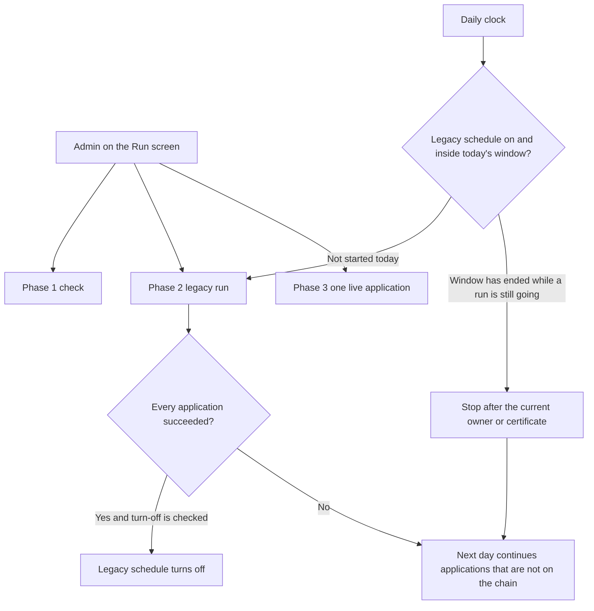
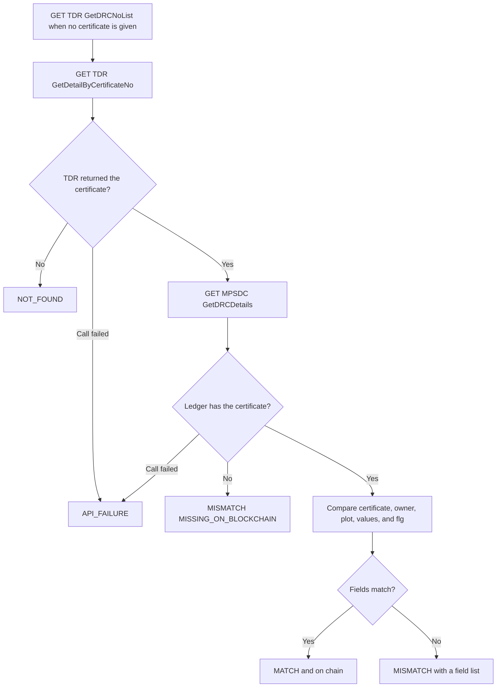
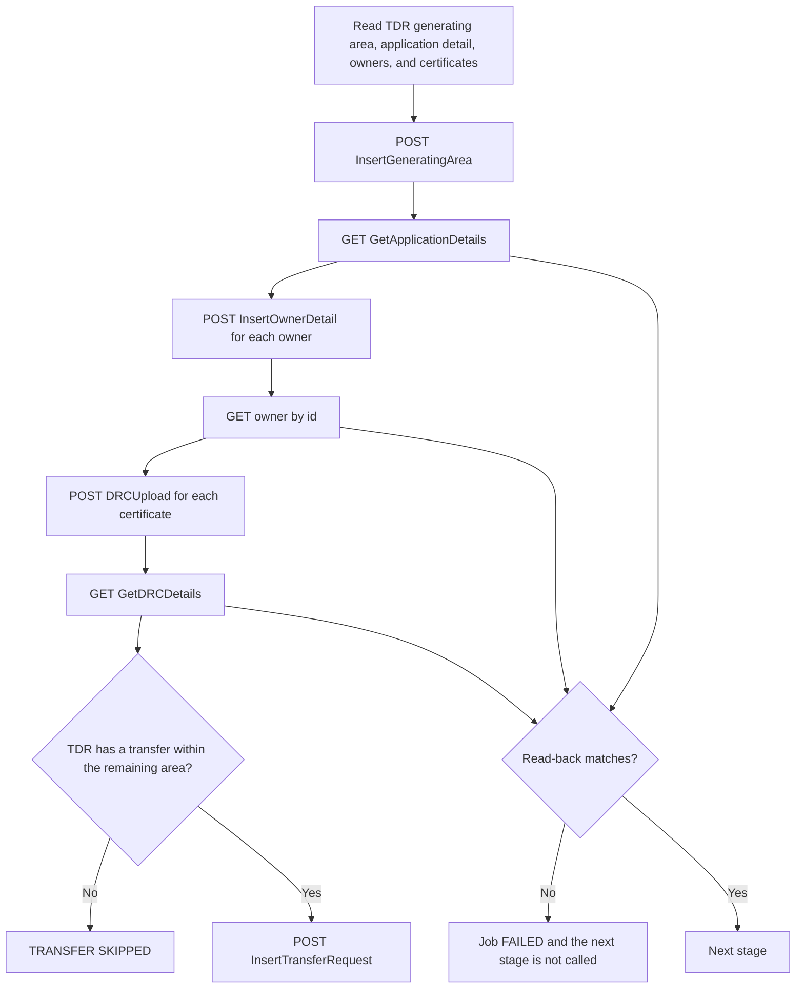

# How the scheduler runs

The scheduler is one Python process. It serves the admin screen and the HTTP API on the same port. It reads TDR and writes the MPSDC blockchain API. It never writes the TDR database.

Times for the legacy daily run use Asia/Kolkata.

## Who starts work

## Phase 1, one certificate

Phase 1 does not write to the blockchain.

## Phase 2 and phase 3, one application

Both use the same write order. A mismatch or a failed call stops the next stage. An "already exists" response from MPSDC is treated as success and the stage still reads the record back.

`flg` on each DRC tells MPSDC what to do:

| flg | Ledger action |
|---|---|
| FIRST_OWNER | generate |
| TRANSFEREE_OWNER | generate |
| TRANSFER_OWNER | update |
| UTILIZATION_OWNER | update |

If a generate flag is sent for a certificate that is already on the ledger, MPSDC updates that certificate. The scheduler still records the TDR flag.

## What each result means

| Result | Meaning |
|---|---|
| MATCH | TDR and the ledger agree |
| MISMATCH | A field differs, or the ledger has no record. The next stage does not run |
| API_FAILURE | TDR or MPSDC did not return usable data. This is not a field mismatch |
| NOT_FOUND | TDR has no such certificate |
| SKIPPED | Nothing to send, or the application was already completed |
| DRY_RUN | The body was built and the blockchain write was not sent |
| SUCCESS | Every stage was MATCH, SKIPPED, or DRY_RUN |
| FAILED | A stage stopped the job. `last_error` has the reason |
| STOPPED | An operator or the end of the daily window stopped the run. The next run continues after the last successful stage |
